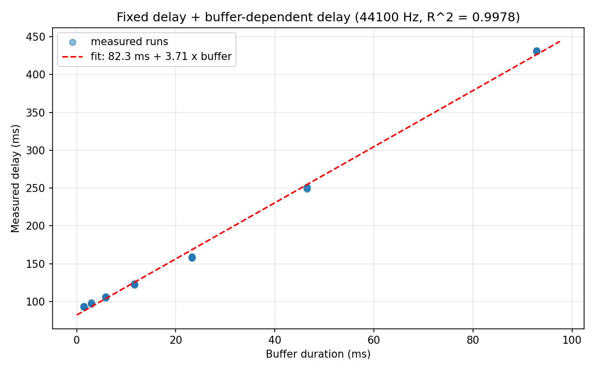
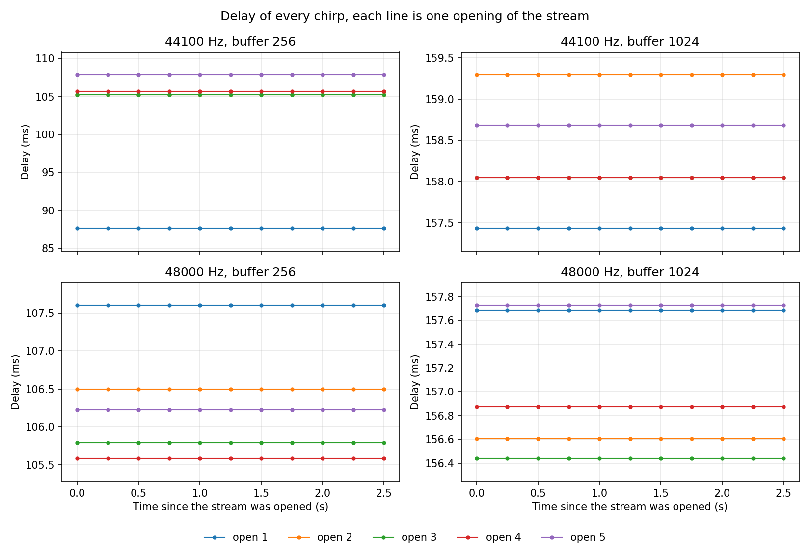
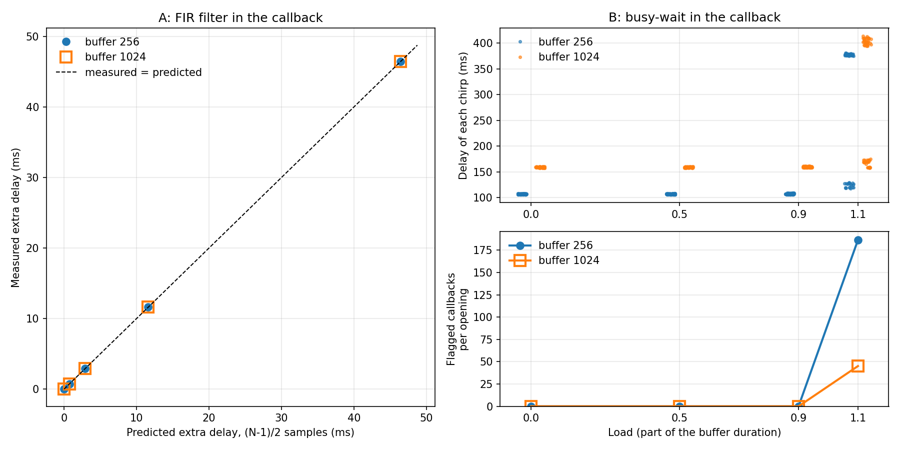

# Audio latency on a laptop

A hearing aid typically needs a latency of less than 10ms. This project
demonstrates how to measure delay using a simple software programme and the
limitations of this method. The audio is sent from the python application,
through the speakers, through the air, into the microphone and back into the
application. The evaluations were performed using the built-in speakers and
microphone of a MacBook Pro.

## Main findings

Tested on a MacBook Pro M2 with macOS 14.2.1, built-in speakers at 44.1 kHz
and built-in microphone at 48 kHz. The full logs are in
`results/logs/`.

| Buffer (samples) | Buffer (ms at 44.1 kHz) | Measured delay (ms, mean +/- std of 5 runs) |
|---:|---:|---:|
| 64 | 1.45 | 93.2 +/- 0.4 |
| 128 | 2.90 | 97.6 +/- 0.7 |
| 256 | 5.80 | 105.9 +/- 0.6 |
| 512 | 11.61 | 122.9 +/- 0.7 |
| 1024 | 23.22 | 158.4 +/- 0.8 |
| 2048 | 46.44 | 250.1 +/- 1.0 |
| 4096 | 92.88 | 431.2 +/- 0.3 |



- The buffer-independent part of the latency is about 90ms. A linear
  regression of all 35 trials gives a delay of 82.3 ms + 3.71 x buffer
  duration (R^2 = 0.998). The intercept is an extrapolation, the minimum
  recorded delay is 92.7 ms and a fit on the buffers up to 1024 gives
  88.7 ms + 2.99 x buffer. Even the smallest buffer is 10 times slower than
  what a hearing aid requires.
- Every millisecond of additional buffering adds 3-4ms of latency . Thus ,
  the audio is going through multiple buffers , each buffer adding some
  delay .
- The hand claps and the laptop responses were recorded with a mobile device
  (steps 6 and 7). Adding the half buffer back in, the phone measures an
  average response time of 98.3 ms (buffer 256) and 166.4 ms (buffer 1024),
  which is off the loop back measurements of 105.9 and 158.4 ms by about
  8 ms.
- Step 8: PortAudio reported latencies from 139 to 203 ms for the four
  stream configurations, but the actual measurements were 28 to 45 ms less,
  which suggests that the driver's estimation is inflated.
- The delay is about the same for 44.1 kHz and 48 kHz. The difference is
  within the 1 to 3 ms that already varies with each stream opening
  (step 10). The speakers were running at 44.1 kHz so the system had to
  resample the 48 kHz stream.
- In step 11, the linear-phase FIR filter in the callback added exactly
  (N-1)/2 samples, and the busy time in the callback did not add any delay
  until it was longer than the buffer duration.

### Stability between stream openings



In step 10 the stream was launched 20 times (5 times for each of the 4
configurations). Starting from the first sample, a short chirp was played
every 0.25 seconds.

- There was a constant delay over an entire opening, not changing even by a
  sample from the first chirp, which means there is no start up phase to
  look for.
- The delay typically differed by 1-3 ms between openings, but one opening
  had an 18 ms lower delay than the rest (87.7 ms versus ~106 ms). The single
  recording of step 3 was also low (83.7 ms).
- The single 30 seconds run of step 8 (44.1 kHz, buffer 256) had a latency
  increase from 106.4 to 120.2 ms, after 23 seconds, which persisted. No
  error message from the audio driver. You could not have seen it simply by
  inspection of the driver's flags.

### Processing inside the callback (step 11)



Step 11 was then executed with the same configuration, using 10 openings per
condition and buffers of 256 and 1024. The first two openings of the first
run without warm-up were about 10 ms higher than the following ones,
therefore the next run starts with one warm-up opening per buffer which is
not saved. Log: `results/logs/step11_10_openings.txt`

A: The output was filtered by a linear-phase low-pass FIR filter with a
cutoff frequency of 10 kHz. The tap counts in a single opening did vary with
the chirps, and the 1-tap filter for that same opening was the reference.
Thus the 1 to 3 ms differences between openings are not important.

| Taps | Expected extra delay, (N-1)/2 samples | Measured, buffer 256 | Measured, buffer 1024 |
|---:|---:|---:|---:|
| 65 | 0.73 ms | 0.73 ms | 0.73 ms |
| 257 | 2.90 ms | 2.90 ms | 2.90 ms |
| 1025 | 11.61 ms | 11.61 ms | 11.61 ms |
| 4097 | 46.44 ms | 46.44 ms | 46.44 ms |

In each opening, the two chirps with the same number of taps differed in
delay by at most one sample (0.02 ms). On average, the filter accounted for
up to 11.4% of the buffer duration. This means the filter is responsible for
the extra delay, not the computation time. Length of filter affects the
10 ms limit in the case of a hearing aid: 4097 taps would take 46 ms.

B: the callback busy-waits for a portion of the buffer duration.

- At 0, 0.5 and 0.9 of the buffer duration, there were no error flags and
  the delay was constant (median 106.70, 106.88 and 107.06 ms at buffer 256;
  159.07, 158.62 and 159.08 ms at buffer 1024).
- At 1.1 the callback was too slow. Each opening had between 181 and 193
  flagged callbacks at a buffer of 256 and between 44 and 46 at a buffer of
  1024. Within each opening the delay jumped between two levels (118.07 to
  380.79 ms at buffer 256, 157.44 to 413.97 ms at buffer 1024).

For the 10 openings at loads from 0 to 0.9, the medians of the openings were
within 2.31 to 3.42 ms of each other at each configuration, which was close
to the 1 to 3 ms observed in step 10.

## How the delay is measured

During recording a linear chirp is emitted through the speakers. A linear
chirp is a sound that sweeps from 200 Hz to 8 kHz (starting at 500 Hz in
steps 10 and 11). The chirp is slid across the recording . At each offset,
the two are multiplied pointwise and summed . This is known as
cross-correlation. The offset with the largest sum indicates the point of
chirp arrival and the delay is calculated as the offset divided by the sample
rate. We use a chirp, which only matches itself at a single offset (as
opposed to a constant tone). In step 1, we show that the known delay of 500
samples is correctly detected even in the presence of added noise (the
amplitude of the chirp is 20 times the standard deviation of the noise).

## Experiments

Run each script from the root of the repo. "Sound" means the script plays
chirps through the speakers and records with the microphone, so turn the
volume up and keep the room quiet.

| Script | What it does | Sound | Output in `results/` |
|---|---|:---:|---|
| `step1_method_check.py` | checks the method on a synthetic chirp with a known delay | no | `fig1_synthetic_validation.png` |
| `step2_wav_delay.py` | same method on two wav files, `measure_latency()` is reused by step 3 | no | `fig2_wav_measurement.png` |
| `step3_real_record.py [buffer]` | one real play-and-record | yes | `fig3_single_measurement_<buffer>.png` |
| `step4_buffer_sweep.py` | 7 buffer sizes x 5 runs, each on a new stream | yes, ~2 min | `latency_results.csv`, `latency_vs_blocksize.png` |
| `step5_linear_fit.py` | fits fixed delay + slope x buffer to step 4 | no | `latency_fit.png` |
| `step6_clap_response.py [buffer]` | answers every hand clap with a short chirp, for a phone to record | yes | none |
| `step7_phone_vs_software.py` | finds clap -> answer pairs in the phone recordings and compares with step 4 | no | `phone_results.csv`, `phone_vs_software.png` |
| `step8_realtime_monitor.py [buffer] [rate] [seconds] [live_plot]` | keeps one stream open and measures once per second | yes, 30 s | `realtime_<rate>_<buffer>.csv` / `.png` |
| `step9_samplerate_compare.py` | compares the step 8 runs at 44.1 and 48 kHz | no | `samplerate_comparison.png` |
| `step10_stream_stability.py [plot]` | opens the stream 20 times, chirp every 0.25 s | yes, ~90 s | `stream_stability.csv` / `.png` |
| `step11_processing_delay.py [openings / test / plot]` | FIR filter and busy-wait inside the callback | yes, ~10 min for 10 openings | `processing_delay.csv` / `.png` |

`common.py` holds the chirp and delay-search code shared by steps 4, 8, 10
and 11. Steps 1 and 2 don't use it, they show the method line by line.

## Reproducing

```bash
python3 -m pip install -r requirements.txt
python3 step1_method_check.py
python3 step4_buffer_sweep.py
python3 step5_linear_fit.py
# ... see the table above
```

You need a phone for steps 6 and 7. Run step 6 and record the laptop with the
phone while clapping every few seconds. Convert the recording to WAV, save it
as `phone/rec_<buffer>.wav` and then run step 7. The original phone and
microphone recordings are not included in this repository because they
contain room sound from a private home, but `results/phone_results.csv` has
every clap/answer pair that was found in them.

When a script records for the first time, macOS asks for microphone access.
Allow it for the terminal you are using.

## Setup

- MacBook Pro (Mac14,7, Apple M2, 8 GB), macOS 14.2.1
- System output volume at 69% with built-in speakers (44.1 kHz) and built-in
  microphone (48 kHz)
- Python 3.13.2, numpy 2.4.6, scipy 1.17.1, matplotlib 3.10.9,
  sounddevice 0.5.6 (PortAudio V19.7.0), soundfile 0.14.0

Details: `results/logs/setup_info.txt`

## Limitations

- One laptop and one room. Tested over several days. The numbers are for the
  audio integrated into the machine, not audio hardware in general. An
  external audio interface would likely be much faster.
- The measured latency includes the time for the sound to travel through air
  from the speakers to the microphone, which is below 1 ms for several tens
  of centimetres.
- Step 7 depends on detecting the onset of a clap in a recording made by a
  phone, which is only accurate to within a few milliseconds.
- In step 8 each configuration was only run once. The jump in one of these
  trials shows that a single run can be misleading . This is why step 10
  repeats the openings .
- The previous version of step 8 resulted in fluctuating delays in runs. The
  outcomes are not considered though, as the driver error indicators were
  not recorded in that iteration and subsequent verification is not
  possible.
- Step 11: The busy-wait is just a time-waster. It is not real signal
  processing. At load 1.1 there were some samples left out, so the program's
  sample count no longer lined up playback and recording and thus those
  delays were not reliable. We have implemented the filter only on the
  output side.

## Licence

MIT, see [LICENSE](LICENSE).
